# ZYNQ ZERO – MicroPython, by Opus 5.5

MicroPython v1.29.0 running bare-metal on CPU0 of the ZYNQ ZERO Rev B
(xc7z010-clg400). The REPL is on UART1, `machine.Pin` drives the PL LEDs through
an AXI GPIO, the `fft` module runs the same transform four ways (Python, C, the
Xilinx FFT IP, and an FFT core written in Verilog), the `hdmi` module puts
a 1280x720 framebuffer on the HDMI connector that you draw on with `framebuf`,
and LVGL v9.6 (`import lvgl as lv`) renders GUIs onto it.

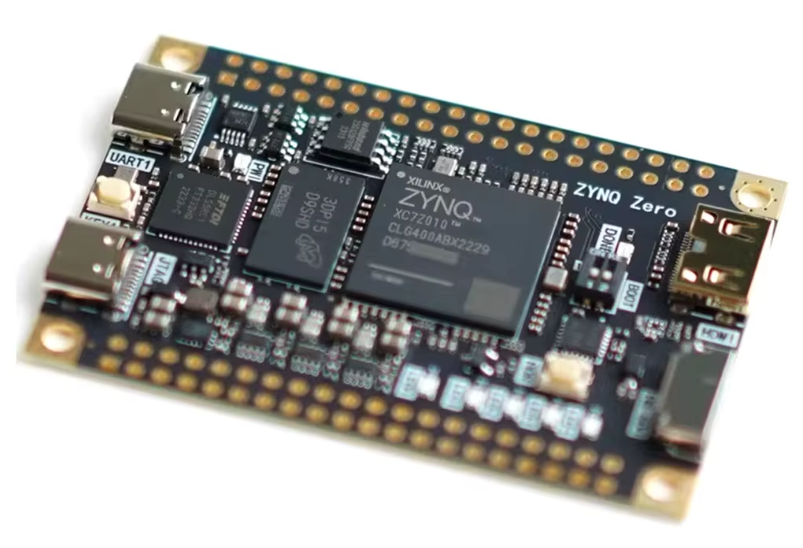

```
  PS (Cortex-A9 CPU0, MicroPython in DDR)            PL (FCLK0 100 MHz)
  ┌───────────────────────────────┐  M_AXI_GP0    ┌──────────────────────────────────┐
  │ UART1 MIO48/49 ── REPL (CH340)│──AXI3──►intc─►│ axi_gpio_0  @0x4120_0000 LEDs/KEY│
  │ GPIO  MIO9     ── LED0        │  AXI4-Lite    │ myfft_0     @0x43C0_0000 own FFT │
  │ fft "python" / "c"            │               │ xfft_ctrl_0 @0x43C1_0000 ─AXIS─► │
  │                               │               │                 xfft_0(Xilinx IP)│
  │ hdmi framebuffers in DDR      │               │ axi_vdma_0  @0x4300_0000(control)│
  │   0x0130_0000, 2 x 1.8 MB     │◄── S_AXI_HP0 ─│   │ RGB565 stream                │
  └───────────────────────────────┘               │   ▼ rgb565_to_888 ─►vid_out◄─v_tc│
                                                  │       ─► hdmi_tx (TMDS)─►HDMI J1 │
                                                  └──────────────────────────────────┘
```

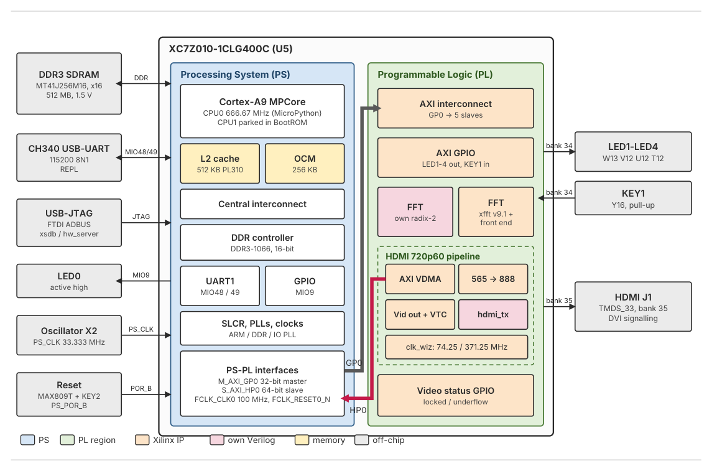
*System overview (architecture.pdf, Figure 1).*

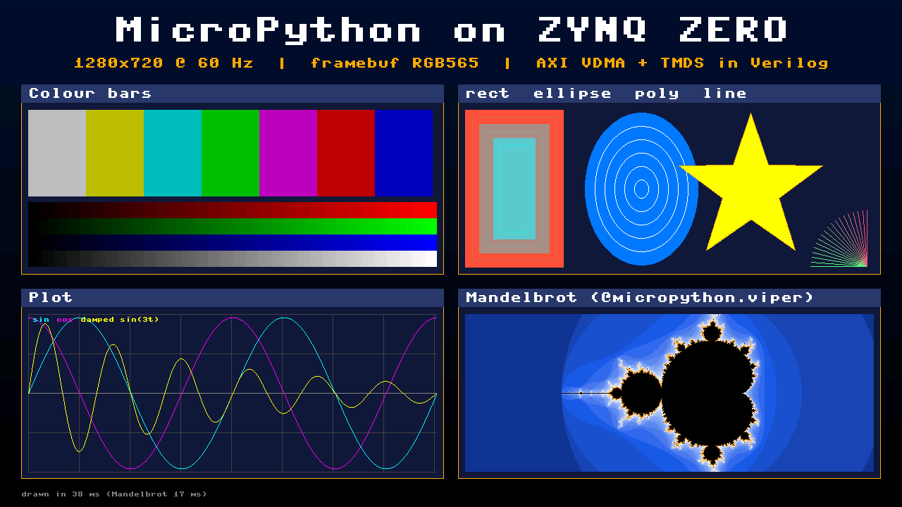
*The HDMI demo test screen, dumped from the framebuffer in QEMU.*

`docs/architecture.pdf` describes the whole system: Zynq configuration, PL design, Verilog modules, IP, the MicroPython port, its drivers and the LVGL integration (`tools/archdoc/` regenerates it with WeasyPrint). The figures in this README are taken from it (`docs/img/`).

The board schematic (ZYNQ ZERO Rev B, 11 A3 sheets) is in [`sch/ZYNQ_ZERO_RevB_Schematic.pdf`](sch/ZYNQ_ZERO_RevB_Schematic.pdf), with a PNG of every sheet in `sch/img/`. See [Hardware: ZYNQ ZERO Rev B schematic](#hardware-zynq-zero-rev-b-schematic).

## Quick start

```bash
./build.sh        # Vivado: hw/build/system.bit + ps7_init.tcl
                  # MicroPython: ports/zynq/build/firmware.elf (clones MicroPython on first run)
./program.sh      # JTAG: rst, load PL, ps7_init, download and run firmware.elf
```

Then open the CH340 serial port at 115200 8N1 (PuTTY or Tera Term on the
Windows COM port, or `picocom -b 115200 /dev/ttyUSB0` in WSL after
`usbipd attach`):

```python
MicroPython v1.29.0 on 2026-11-14; ZYNQ ZERO with XC7Z010 Cortex-A9
>>> from machine import Pin
>>> led = Pin("LED1", Pin.OUT)
>>> led.on(); led.toggle(); led.value()
0
>>> Pin("KEY1", Pin.IN).value()      # 0 while pressed
1
```

Run a script from your PC with `mpremote` (raw REPL is supported):

```bash
pip install mpremote
mpremote connect COM5 run examples/knight_rider.py      # or /dev/ttyUSB0
```

Everything is loaded over JTAG and is lost at power-off. SW1 must be set to JTAG boot.

`prebuilt/firmware.elf` is a ready-built firmware, so you can skip the MicroPython build:
`./build.sh hw && ./program.sh hw/build/system.bit hw/build/ps7_init.tcl prebuilt/firmware.elf`

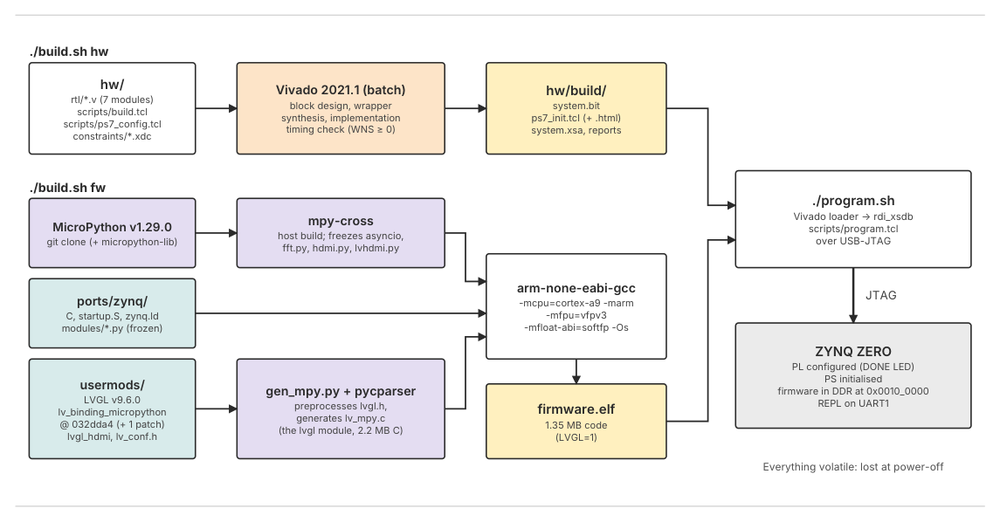
*Build flow: `build.sh hw` (Vivado) and `build.sh fw` (MicroPython, LVGL binding, cross compiler), then `program.sh` (architecture.pdf, Figure 11).*

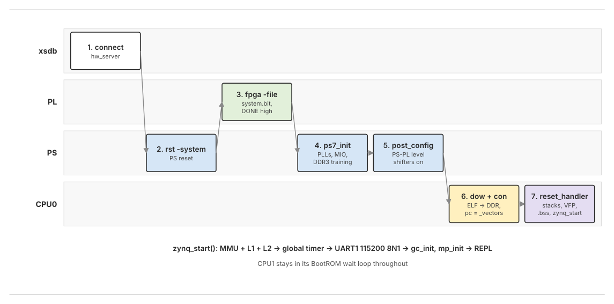
*What `program.sh` does over JTAG (architecture.pdf, Figure 12).*

The REPL and JTAG each have their own USB-C connector on the board: P1 goes to the CH340E USB-UART and
P2 to the FT232HL JTAG adapter (schematic sheets 4 and 5). PS UART1 runs at 1.8 V and the CH340E at 3.3 V,
so two 74LVC1T45 single-bit translators sit between them:

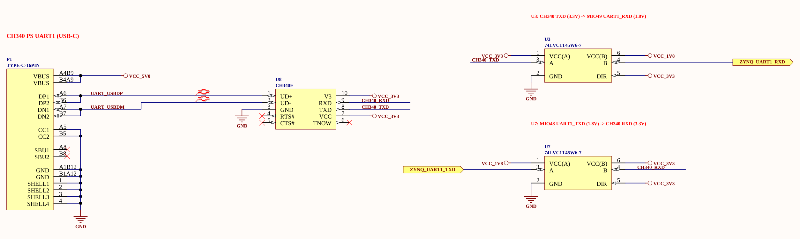
*Schematic sheet 4, USB UART.*

## machine.Pin

| Name    | Where                        | Modes         |
|---------|------------------------------|---------------|
| `LED0`  | PS GPIO, MIO9                | `IN`, `OUT`   |
| `LED1`–`LED4` | PL AXI GPIO ch 1, bits 0–3 (W13, V12, U12, T12) | `OUT` only |
| `KEY1`  | PL AXI GPIO ch 2, bit 0 (Y16) | `IN` only (0 = pressed) |

Names are case-insensitive. `Pin(name, mode=-1, *, value=None)`, then
`value([x])`, `on()`, `off()`, `toggle()`, `init(mode, value=...)`, `pin()` / `pin(x)`.
Pins implement the virtual-pin protocol, so `machine.Signal(Pin("KEY1"), invert=True)`
works.

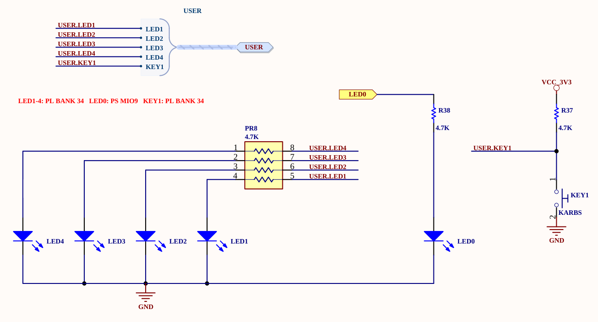
*Schematic sheet 11: the LEDs are active high, each through a 4.7 kΩ resistor (PR8, R38); KEY1 pulls
Y16 to GND against R37 (4.7 kΩ to 3.3 V), so it reads 0 while pressed.*

Other things that work: `time` (sleep, ticks_ms/us/cpu, from the ARM global
timer), `asyncio` (frozen), `machine.mem32` for poking any AXI register, `machine.freq()`,
`machine.reset()`, `machine.soft_reset()` / Ctrl-D, Ctrl-C to interrupt running
code, paste mode (Ctrl-E), double-precision floats on the VFP, and
`@micropython.native` / `@micropython.viper`.

There's no filesystem: code comes from the REPL, paste mode or `mpremote run`.
`gc.mem_free()` is about 16 MB (set with `HEAP_SIZE`).

## fft module

```python
>>> import fft
>>> fft.info()
xilinx   0x43c10000  engine XFFT
verilog  0x43c00000  engine MFFT
>>> X = fft.fft([1, 2, 3, 4, 0, 0, 0, 0], "verilog")    # list of complex
>>> fft.ifft(X, "xilinx")
>>> fft.benchmark(1024)                                 # all four: time + error
```

| method      | runs on                  | implementation | sizes |
|-------------|--------------------------|----------------|-------|
| `"python"`  | Cortex-A9, MicroPython   | radix-2 DIT in `ports/zynq/modules/fft.py`, double | any 2^k |
| `"c"`       | Cortex-A9, C             | radix-2 DIT in `ports/zynq/modfft.c`, double, VFP | 2..65536 |
| `"xilinx"`  | PL, Xilinx FFT LogiCORE  | xfft radix-2 burst, 16-bit in, unscaled 27-bit out, behind `hw/rtl/xfft_ctrl.v` | 8..1024 |
| `"verilog"` | PL, own RTL              | `hw/rtl/myfft_axil.v`: radix-2 DIT, 1 butterfly/clock, 16-bit, ½ per stage | 8..1024 |

All four follow numpy's conventions: forward = Σ x·e^(−j…), inverse = (1/N)·Σ X·e^(+j…).
`fft.fft(x, method)` and `fft.ifft(X, method)` take and return lists. For speed, `fft.run(re, im,
method, inverse)` works in place on two `array('d')` and returns the PL cycle count for the
hardware methods.

`fft.benchmark()` prints two times for the PL engines. "total" is the whole call from Python;
"PL" is the transform alone, from the engine's cycle counter. Expect "total" to be
dominated by moving the samples: each one is a single-beat AXI4-Lite access over GP0
(N writes in, N or 2N reads out). The own core needs log2(N)·(N/2 + 6) cycles, which is
5180 cycles (52 µs) for 1024 points. The next step for speed would be an AXI DMA over an HP port.

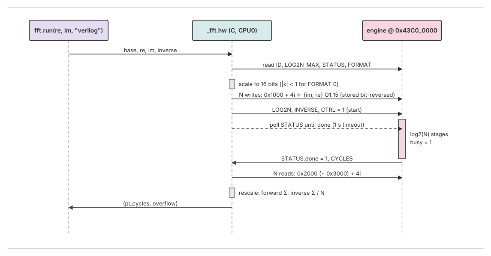
*What `fft.run(re, im, "verilog")` does on the bus (architecture.pdf, Figure 16).*

### Fixed point in the PL

The driver (`_fft.hw` in `modfft.c`) scales the input into 16 bits, runs the engine, and
scales the result back into the same units as the C version:

- **Own core (FORMAT 0):** every stage computes (a ± W·b)/2 and rounds to 16 bits, so the
  word never grows and can't overflow if every input |x| < 1. The driver scales the
  largest |x| to 0.9. The output is FFT/N, and the error is at most about ½ LSB per stage.
  When the energy is spread across many bins (noise), each bin keeps fewer significant
  bits, so relative error rises to about 1e-3 at N = 1024.
- **Xilinx core (FORMAT 1):** unscaled mode keeps full precision (16 + log2 N + 1 bits),
  so the input is scaled to full 16-bit range per component, nothing overflows, and relative
  error stays near 1e-5, limited by the 16-bit input and 16-bit phase factors.

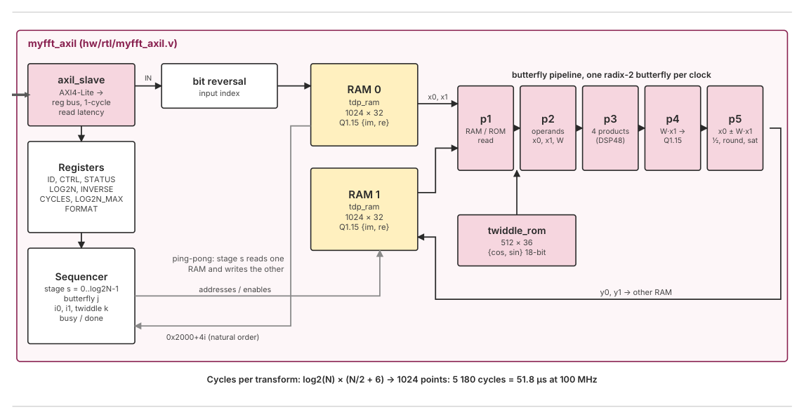
*The own engine, `myfft_axil.v` (architecture.pdf, Figure 6).*

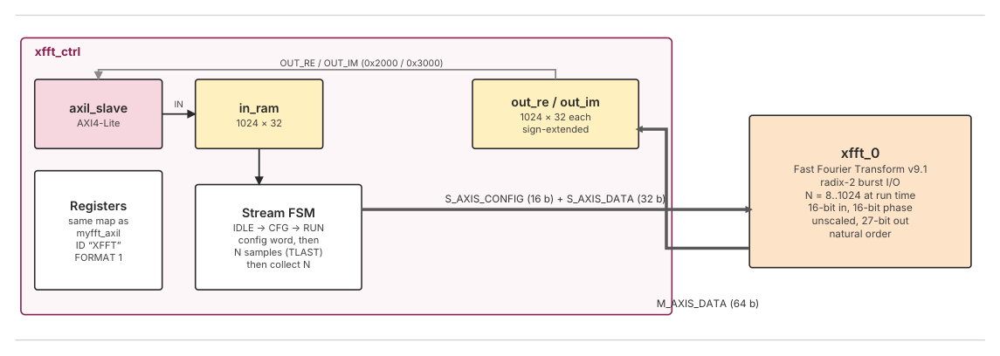
*The Xilinx engine behind `xfft_ctrl.v` (architecture.pdf, Figure 7).*

### Engine register map (both engines, 64 KB windows)

| offset | name | |
|---|---|---|
| 0x0000 | ID | `0x4D464654` "MFFT" (own) / `0x58464654` "XFFT" (Xilinx) |
| 0x0004 | CTRL | write bit 0 = start |
| 0x0008 | STATUS | bit 0 busy, bit 1 done, bit 2 overflow |
| 0x000C | LOG2N | 3..10 |
| 0x0010 | INVERSE | bit 0 |
| 0x0014 | CYCLES | clock cycles of the last transform |
| 0x0018 | LOG2N_MAX | 10 |
| 0x001C | FORMAT | 0 = packed Q1.15 at 0x2000, scaled 1/N; 1 = int32 re at 0x2000, im at 0x3000, unscaled |
| 0x1000 + 4i | input | {im[31:16], re[15:0]}, Q1.15, natural order |
| 0x2000 + 4i | output | see FORMAT |

The PL window is mapped strongly-ordered by the MMU (as in Xilinx's BSP), so a STATUS
read can never overtake the START write.

### Simulation

`./build.sh sim` runs both engines in iverilog (`hw/sim/`) through the same AXI4-Lite
sequence the driver uses: 4 signals × forward/inverse × N = 8..1024. It checks each
result against numpy in output LSBs. It also runs `tb_hdmi.v`:
the TMDS encoder against a reference decoder (about 50k symbols, DC balance checked), and the
whole `hdmi_tx` through serializer models with a deserializer that locks to the clock
lane, comparing every pixel and sync. The Xilinx core is replaced by a behavioural model
(`xfft_model.v`, an exact DFT with random back-pressure on both streams), so that run
checks `xfft_ctrl.v`'s protocol: config word, TLAST, flow control, output capture and sign
extension. Needs `iverilog` and `python3-numpy`.

## HDMI output (720p)

```python
import hdmi
disp = hdmi.Display()                 # starts 1280x720 @ 60 Hz output, black screen
fb = disp.fb                          # framebuf.FrameBuffer, RGB565
fb.fill_rect(100, 100, 400, 200, hdmi.rgb(255, 128, 0))
fb.ellipse(640, 360, 200, 120, hdmi.CYAN, True)
fb.line(0, 0, 1279, 719, hdmi.WHITE)
hdmi.text(fb, "Hello HDMI", 100, 400, hdmi.WHITE, scale=4)   # framebuf font, scaled
disp.show()                           # write the cache back, picture appears
```

- **Drawing:** every `framebuf` method works on `disp.fb`: `fill`, `pixel`, `hline`/`vline`/`line`,
  `rect`, `ellipse`, `poly`, `text`, `scroll`, `blit`. `hdmi.rgb(r, g, b)` makes RGB565
  colours, and `BLACK`, `WHITE`, `RED`, `GREEN`, `BLUE`, `YELLOW`, `CYAN`, `MAGENTA`, `ORANGE`, `GREY` are predefined.
- **`show()`:** call it after drawing. The CPU draws through its write-back data cache and
  the VDMA reads DDR over HP0, which isn't cache-coherent, so `show()` writes the
  framebuffer's cache lines back (about 1.8 MB).

  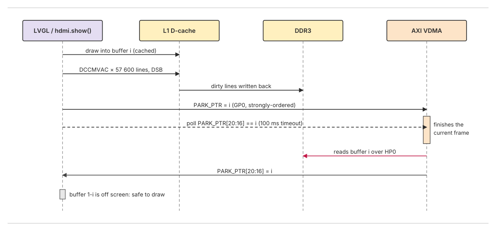
  *Presenting a frame (architecture.pdf, Figure 17).*
- **Double buffering:** `hdmi.Display(double_buffer=True)` draws into the hidden buffer, and `show()`
  makes the VDMA switch to it at the next frame, waiting until it has. `disp.fb` then
  points at the other buffer, so redraw the whole frame. The animation in the demo works
  this way and is tear-free, capped at 60 fps.
- **Direct access:** `disp.buffer()` is the raw `bytearray` (little-endian RGB565, 2560 bytes per line).
  The demo's Mandelbrot writes it directly from `@micropython.viper` code.
- **Diagnostics:** `disp.status()` returns `mmcm_locked`, `video_locked`, `underflow`, `halted`, `error`, `frame`.
- **Without hardware:** `hdmi.Display(hardware=False)` gives the same framebuffers without the hardware (QEMU).

Run the demo with `mpremote connect COM5 run examples/hdmi_demo.py`. It draws the test screen
shown above, then animates bouncing balls for 20 s.

### The video pipeline

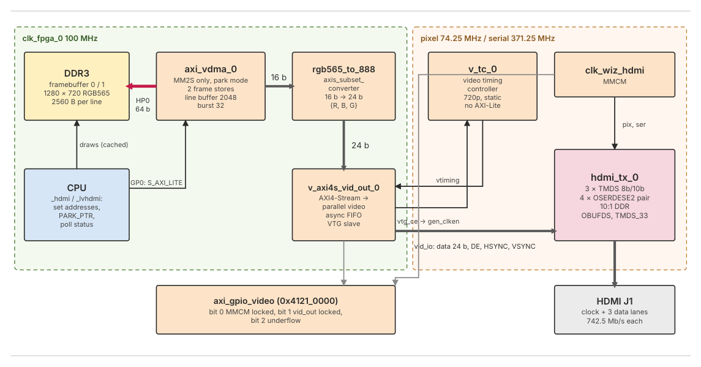
*The video path and its two clock domains (architecture.pdf, Figure 8).*

| block | what | |
|---|---|---|
| `axi_vdma_0` | Xilinx AXI VDMA | reads the framebuffer from DDR over HP0 (64-bit), 2 frame stores, park mode |
| `rgb565_to_888` | Xilinx AXI4-Stream Subset Converter | 16 → 24 bits, `{R,B,G}` order, low bits replicated |
| `v_axi4s_vid_out_0` | Xilinx AXI4-Stream to Video Out | async FIFO 100 → 74.25 MHz, adds blanking and syncs |
| `v_tc_0` | Xilinx Video Timing Controller | fixed 720p preset (no AXI-Lite), slaved via `vtg_ce` |
| `clk_wiz_hdmi` | Xilinx Clocking Wizard | MMCM from FCLK0: 74.25 MHz pixel, 371.25 MHz serial |
| `hdmi_tx_0` | **own RTL** `hw/rtl/hdmi_tx.v` | 3× TMDS encoder (`tmds_encoder.v`), OSERDESE2 10:1 DDR, OBUFDS |
| `axi_gpio_video` | Xilinx AXI GPIO | status in: MMCM locked, video locked, underflow |

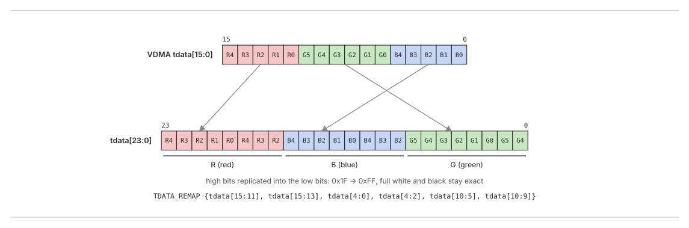
*RGB565 → `{R,B,G}` by bit remapping (architecture.pdf, Figure 9).*

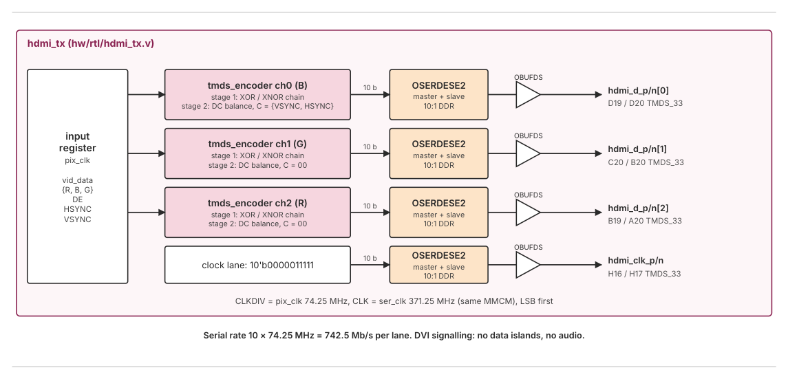
*`hdmi_tx.v` (architecture.pdf, Figure 10).*

The output is DVI-style TMDS: video only, no HDMI data islands or audio, which every HDMI
monitor accepts. Xilinx's HDMI TX subsystem is a paid licence and doesn't target this
part, so the TMDS encoder and serializer are written by hand. The pins are TMDS_33 on bank
35 (3.3 V). The DDC buffer U15 isn't fitted, so the board can't read the monitor's EDID: it
always sends 720p60 (CEA-861: 1650×750 total, positive syncs), which practically every
display supports.

| TMDS pair | J1 (mini HDMI) pins | Zynq ball (P / N), bank 35 | net |
|---|---|---|---|
| clock | 11 / 12 | H16 / H17 (L13, MRCC) | `HDMI.CLK_P/N` |
| data 0 (blue) | 8 / 9 | D19 / D20 (L4) | `HDMI.D0_P/N` |
| data 1 (green) | 5 / 6 | C20 / B20 (L1) | `HDMI.D1_P/N` |
| data 2 (red) | 2 / 3 | B19 / A20 (L2) | `HDMI.D2_P/N` |

These match `hw/constraints/zynq_zero.xdc`. Each TMDS line has a 51 Ω pull-up to 3.3 V (PR6, PR7), the
sink gets +5 V from VCC_5V0 through D4, and HPD goes through R36. DDC DATA / DDC CLK aren't connected
on J1, which is why there's no EDID.

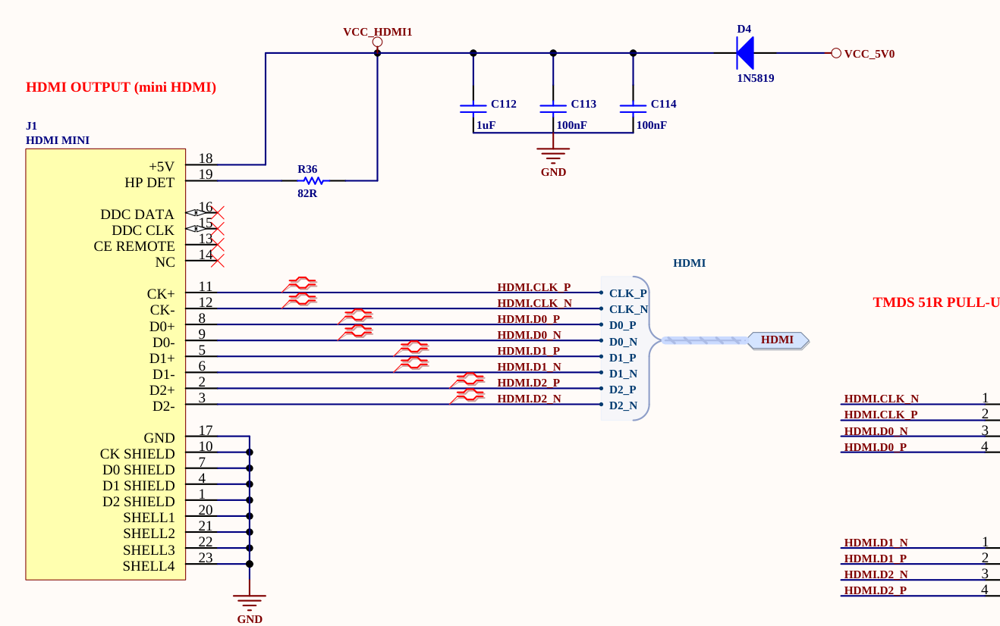
*Schematic sheet 10, HDMI output (U15 / PR5, the DDC translator, are not fitted and are cropped off).*

The framebuffers live in their own section at 0x0130_0000 (`zynq.ld`), outside the GC heap.

## LVGL v9.6

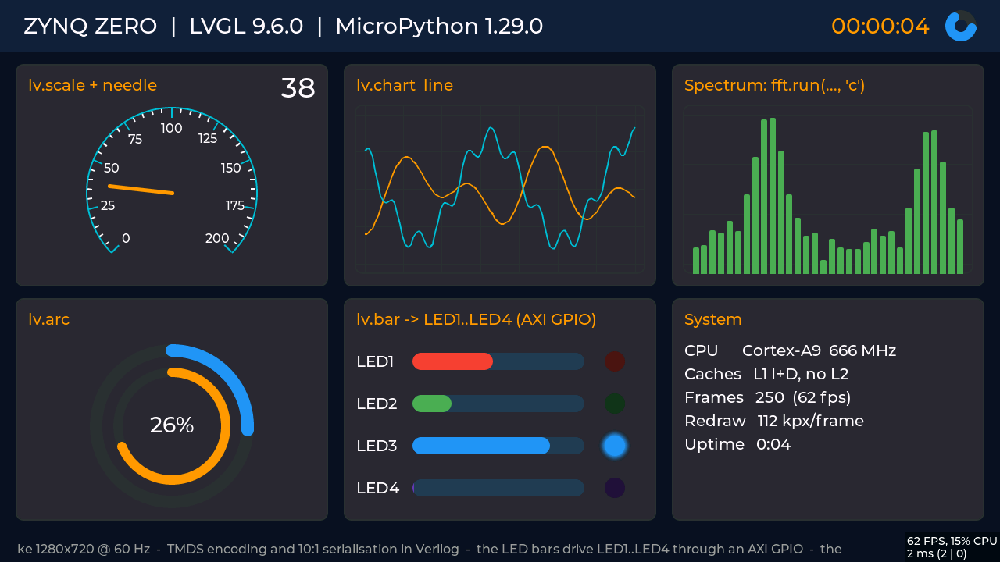

```python
import lvgl as lv
import lvhdmi

lvhdmi.init()                                   # HDMI + LVGL + default dark theme
label = lv.label(lv.screen_active())
label.set_text("Hello LVGL")
label.set_style_text_font(lv.font_montserrat_48, 0)
label.center()
lvhdmi.run()                                    # LVGL loop; Ctrl-C stops it
```

`examples/lvgl_demo.py` is the non-interactive dashboard above. Every widget moves on
LVGL animations and timers, and nothing needs an input device:

| Card | What it shows |
|---|---|
| `lv.scale` + needle | A gauge whose needle swings with an overshoot animation. |
| `lv.chart` line | Two scrolling line series. |
| Spectrum | A bar chart of a live 128-point FFT, computed by this firmware's `fft.run(..., "c")`. |
| `lv.arc` | Two concentric arcs on different periods. |
| `lv.bar` + `lv.led` | Four bars whose LEDs also switch the board's real LED1–LED4 through the AXI GPIO. |
| System | Cache setup, frames/fps, pixels redrawn per frame and uptime. |

The header has a spinner and an uptime clock, and the footer is a scrolling label.
Run it with `mpremote connect COM5 run examples/lvgl_demo.py`.

**Performance:** at realistic CPU speed (QEMU `-icount`, about a 666 MHz A9) the full dashboard
runs at 60 fps with about 20 % CPU, redrawing about 110 kpx per frame. To check the board,
copy `examples/lvgl_demo.py` to it (`mpremote cp examples/lvgl_demo.py :`) and run
`mpremote run examples/lvgl_perf.py`: it prints the cache setup (`zynq.info()`, all True) and
10 s of fps, CPU, redraw and memory figures. `lvhdmi.stats()` and `lvhdmi.mem()` give the same
figures in your own code. Things that cost frames:
- **Many changes in one frame:** LVGL keeps 64 invalidated areas per frame (`LV_INV_BUF_SIZE`);
  past that it redraws the whole 1280×720 screen. Updating 32 chart points one by one did that
  every 100 ms. Batch them: `disp.enable_invalidation(False)`, change the values,
  `disp.enable_invalidation(True)`, then `chart.refresh()`.
- **`gc.mem_free()` in a timer:** it walks the whole 16 MB heap, about 0.1 s per call.
- **Big areas each frame:** LVGL redraws only what changed; a widget that changes every frame
  costs its whole area. `stats()` shows areas and pixels per frame and full-screen redraws.

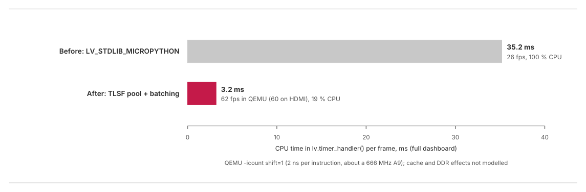
*CPU time per frame for the dashboard, before and after moving LVGL to its own TLSF pool (architecture.pdf, Figure 21).*

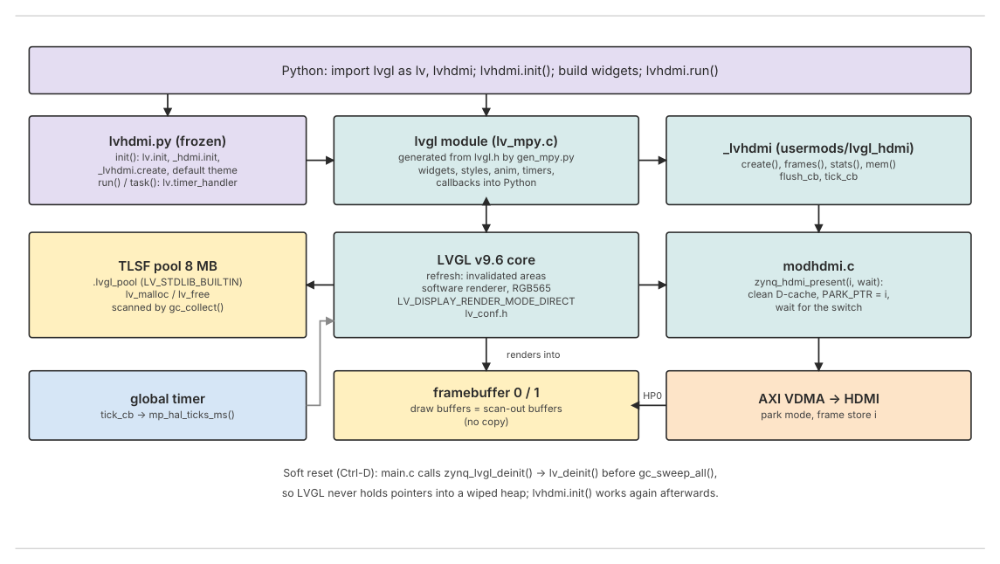
*LVGL in the firmware (architecture.pdf, Figure 18).*

**How it's wired:**
- **Display:** `usermods/lvgl_hdmi/lvgl_hdmi.c` (`_lvhdmi`) gives LVGL the two HDMI framebuffers
  as its draw buffers in DIRECT render mode with double buffering. LVGL draws straight into
  video memory, with no flush copies. When a frame's last area is flushed, the driver writes
  that buffer back from the D-cache and parks the VDMA on it, waiting for the switch. The
  picture never tears, and LVGL never draws into the buffer on screen (capped at 60 fps).

  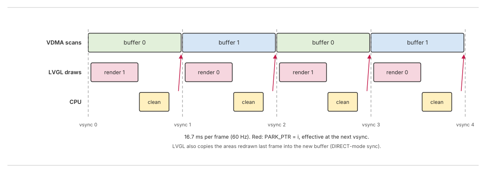
  *Double buffering in DIRECT mode (architecture.pdf, Figure 19).*
- **Tick and loop:** the tick is `lv_tick_set_cb` on the CPU timer. Drive LVGL with `lvhdmi.run()`, or
  `asyncio.create_task(lvhdmi.task())` alongside other tasks.
- **Memory:** LVGL allocates from its own 8 MB TLSF pool (`LV_STDLIB_BUILTIN`, `LV_MEM_SIZE`),
  placed in its own linker section (`.lvgl_pool`). `gc_collect()` scans that pool, so Python
  callbacks and objects that only LVGL refers to stay alive. The binding's default,
  `LV_STDLIB_MICROPYTHON`, put LVGL's per-frame draw buffers in the 16 MB GC heap. MicroPython's
  allocator searches its block table linearly for every multi-block allocation, so with a heap
  that size `gc_alloc` took about 80 % of the CPU, and the dashboard ran at about 1 fps.

  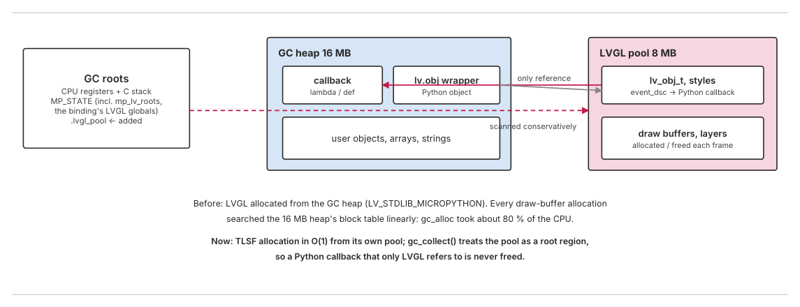
  *The LVGL pool as a GC root region (architecture.pdf, Figure 20).*
- **Soft reset:** Ctrl-D shuts LVGL down before the heap is wiped (`zynq_lvgl_deinit`), so
  `lvhdmi.init()` works again after a soft reset.
- **Monitor:** the FPS/CPU monitor in the bottom-right corner comes from `LV_USE_SYSMON`.

**Build:** `./build.sh fw` fetches everything into `usermods/` on the first run, which takes about
2 minutes including generating the binding:
- **lv_binding_micropython** at commit `032dda4b`, with its pycparser submodule.
- **LVGL** v9.6.0, placed in `usermods/lv_binding_micropython/lvgl/`.
- **One patch** for MicroPython 1.29: `mp_obj_int_to_bytes_impl` becomes `mp_obj_int_to_bytes` in
  `gen/gen_mpy.py`, applied with `sed`.

Your `lv_conf.h` is `usermods/lv_conf.h`. It's the binding's config with `LV_USE_STDLIB_MALLOC
LV_STDLIB_BUILTIN` and `LV_MEM_SIZE` 8 MB, `LV_DEF_REFR_PERIOD 16`, `LV_INV_BUF_SIZE 64`,
Montserrat 12/14/16/20/24/28/36/48 and `LV_USE_SYSMON 1`. Whatever is enabled there appears
in `lv`, and whatever is disabled disappears from it. The firmware grows from about 0.27 MB to
1.4 MB of code. `LVGL=0 ./build.sh fw` builds without LVGL. Run `./build.sh clean` when switching
between the two, because make can't see the change.

Binding names that differ from older LVGL docs, all checked on v9.6 here:
- **Charts:** `chart.set_axis_range`, `chart.set_series_value_by_id`.
- **Animations:** `anim.set_reverse_duration`, `lv.ANIM_REPEAT_INFINITE`.
- **Labels:** `lv.label.LONG_MODE.SCROLL_CIRCULAR`.
- **Gauge needle:** `scale.set_line_needle_value(needle, length, value)`.
- **Animated setters:** the anim-enable argument of `bar.set_value(v, anim)` is a plain bool.

## Hardware: ZYNQ ZERO Rev B schematic

[`sch/ZYNQ_ZERO_RevB_Schematic.pdf`](sch/ZYNQ_ZERO_RevB_Schematic.pdf) is the board schematic: a
hierarchical top sheet and ten sub-sheets, all A3. `sch/img/` has each sheet as a 150 dpi PNG, plus the
detail crops used in this README.

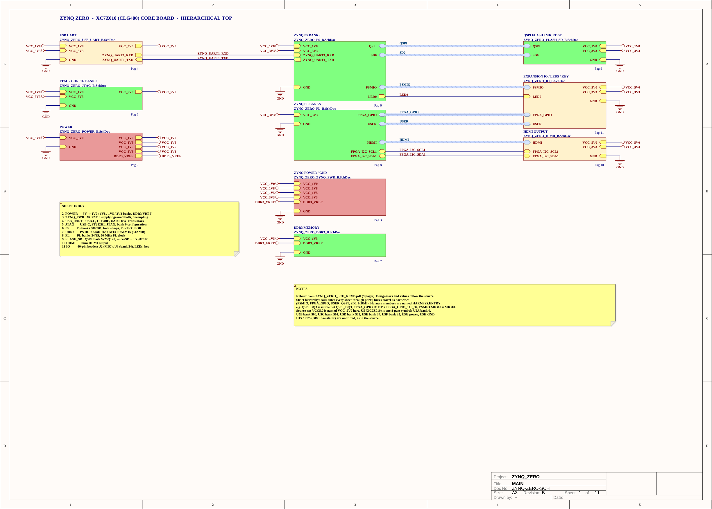
*Sheet 1, the hierarchical top: every sub-sheet and the harnesses between them.*

| sheet | title | what's on it | used by this project |
|---|---|---|---|
| [1](sch/img/sheet01_main.png) | MAIN | hierarchy, sheet index, notes | |
| [2](sch/img/sheet02_power.png) | POWER | USB VBUS 5 V → MP2145 1.0 V / 6 A core, three MP2143 bucks for 1.8 V, 1.5 V (DDR3) and 3.3 V, chained on power-good; DDR3 VREF | everything |
| [3](sch/img/sheet03_zynq_power_gnd.png) | ZYNQ POWER / GND | XC7Z010 supply and ground balls, decoupling | |
| [4](sch/img/sheet04_usb_uart.png) | USB UART | USB-C P1, CH340E, 74LVC1T45 translators to MIO48/49 | REPL on UART1 |
| [5](sch/img/sheet05_jtag_config.png) | JTAG / CONFIG BANK 0 | USB-C P2, FT232HL JTAG, bank 0 configuration, XADC | `program.sh` |
| [6](sch/img/sheet06_ps_banks.png) | ZYNQ PS BANKS | MIO banks 500/501, boot-mode switch SW1 and straps, PS_CLK 33.333 MHz (X2), MAX809T power-on reset + KEY2 | UART1, LED0 (MIO9), PS clock |
| [7](sch/img/sheet07_ddr3.png) | DDR3 MEMORY | PS bank 502 + MT41J256M16HA-125 (4 Gb x16, 512 MB) | firmware, heap, framebuffers |
| [8](sch/img/sheet08_pl_banks.png) | ZYNQ PL BANKS | PL banks 34 and 35 (3.3 V), 50 MHz PL oscillator X3 on K17 | LEDs, KEY1, HDMI |
| [9](sch/img/sheet09_qspi_sd.png) | QSPI FLASH / MICRO SD | W25Q128FV on QSPI0 (default boot device), microSD via TXS02612 | not used (JTAG boot) |
| [10](sch/img/sheet10_hdmi.png) | HDMI OUTPUT | mini HDMI J1, TMDS pull-ups, DDC translator (not fitted) | `hdmi`, LVGL |
| [11](sch/img/sheet11_expansion_io_leds_key.png) | EXPANSION IO / LEDS / KEY | 2×20 headers J2 (PS MIO) and J3 (PL bank 34), LED0–LED4, KEY1 | `machine.Pin` |

The PL banks, with the user LEDs and KEY1 on bank 34 and the TMDS pairs on bank 35:

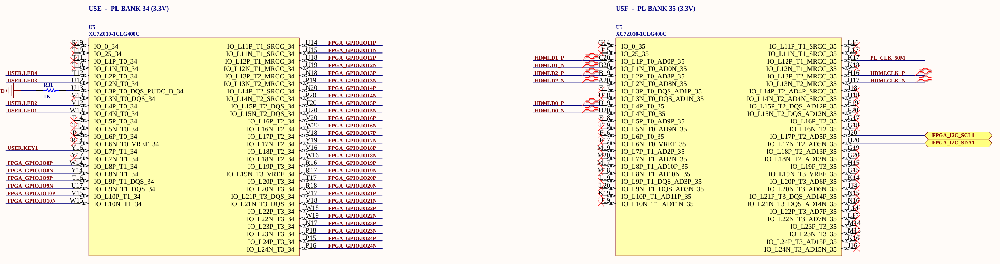
*Schematic sheet 8, PL banks (`hw/constraints/zynq_zero.xdc` takes its pins from here).*

The design clocks the PL from the PS (FCLK0, 100 MHz) and the HDMI MMCM from FCLK0 as well, so the
board's 50 MHz oscillator X3 (`PL_CLK_50M`, K17) isn't used:

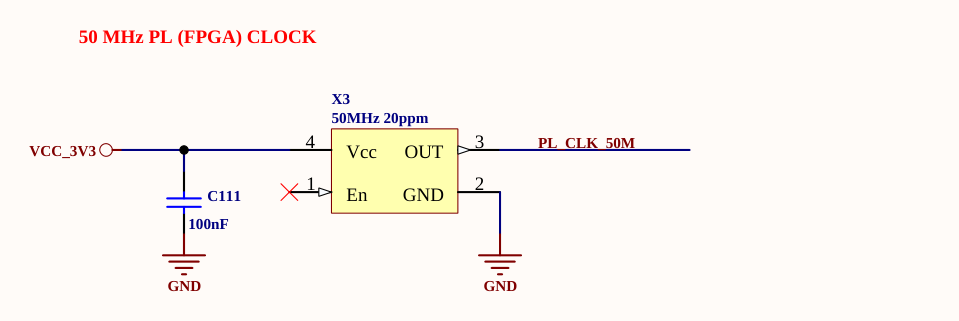

The clock tree and address map that the PS configuration sets up on this hardware:

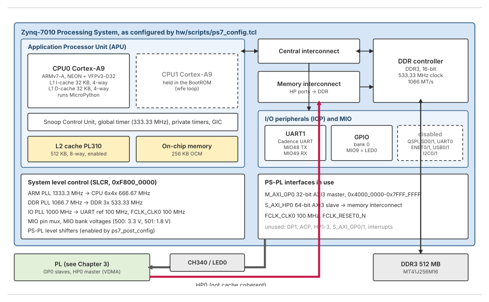
*Processing system blocks and how the design uses them (architecture.pdf, Figure 2).*

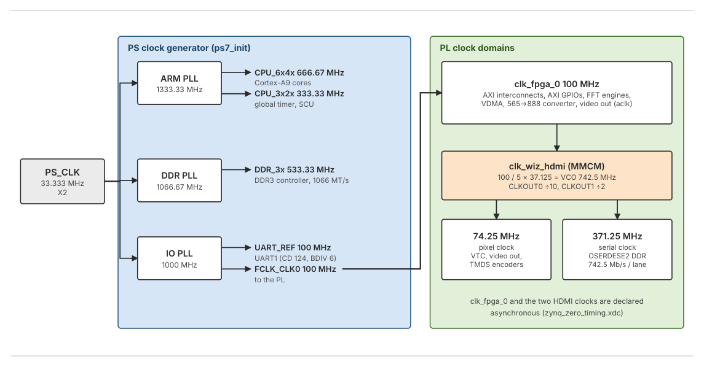
*Clock tree, from PS_CLK (X2, 33.333 MHz) to the CPU, DDR, UART, FCLK0 and the HDMI clocks (architecture.pdf, Figure 3).*

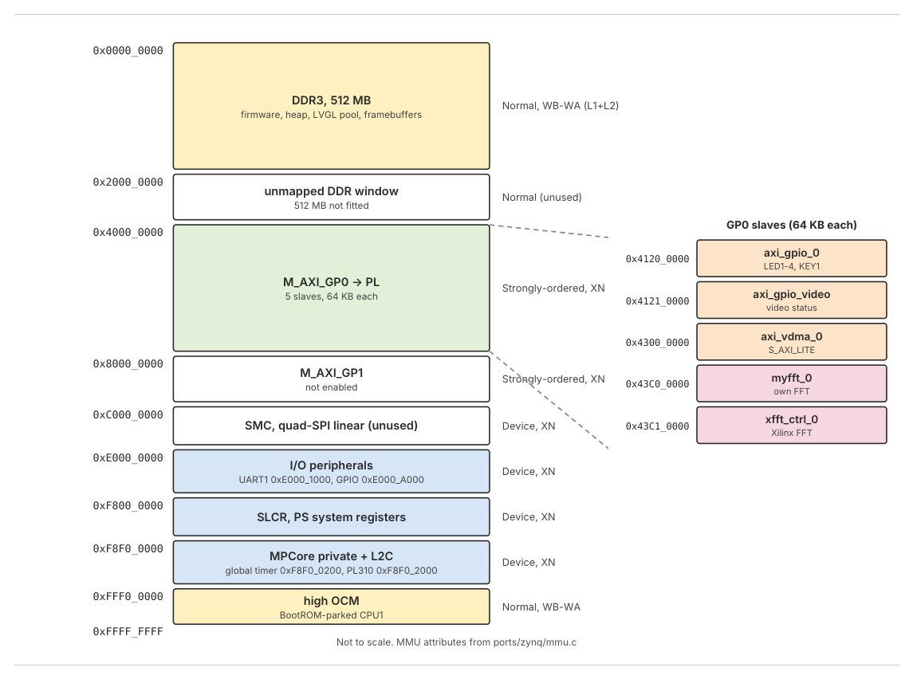
*Address map and MMU attributes (architecture.pdf, Figure 4).*

## Requirements

- Vivado 2021.1 (`VIVADO_ROOT=...` if not at `/tools/Xilinx/Vivado/2021.1`)
- `arm-none-eabi-gcc` (`sudo apt install gcc-arm-none-eabi`), or the one in Vitis, or
  `CROSS_COMPILE=...`
- Host `gcc`, `make`, `python3`, `git` (MicroPython builds `mpy-cross` to freeze asyncio;
  the LVGL binding generator runs on `python3` with the bundled pycparser)

## Layout

```
build.sh, program.sh          entry points (see top of each)
hw/scripts/build.tcl          block design: ps7, AXI interconnect, axi_gpio_0, myfft_0,
                              xfft_ctrl_0 + xfft_0; synth/impl/bit
hw/scripts/ps7_config.tcl     PS settings: CPU 666 MHz, UART1, MIO9 GPIO, DDR3 x16, GP0, FCLK0
hw/constraints/zynq_zero.xdc  leds_tri_o[3:0], keys_tri_i[0], hdmi_* (TMDS_33)
hw/constraints/zynq_zero_timing.xdc   HDMI clocks asynchronous to FCLK0 (impl only)
hw/rtl/                       axil_slave.v (AXI4-Lite -> register bus), tdp_ram.v,
                              myfft_axil.v + twiddle_rom.v (gen_twiddle.py), xfft_ctrl.v,
                              hdmi_tx.v + tmds_encoder.v
hw/sim/                       tb_fft.v, xfft_model.v, tb_hdmi.v, unisim_stubs.v, run_sim.py
scripts/program.tcl           xsdb: rst, fpga, ps7_init, ps7_post_config, dow, con
ports/zynq/                   the MicroPython port (out of tree, MICROPY_DIR=...)
  startup.S                   vectors, modes/stacks, VFP, .bss
  mmu.c                       flat map: DDR cached, PL strongly-ordered, peripherals device,
                              L1 I/D caches, 512 KB L2 (framebuffers L1-only)
  modzynq.c                   zynq.info(): MMU/cache state, to check on the board
  uart.c                      polled UART1, Ctrl-C detection
  mphalport.c                 stdio, ticks and delays (global timer at 333 MHz)
  machine_pin.c               machine.Pin (AXI GPIO + PS GPIO)
  modfft.c                    _fft: C FFT and the PL engine driver
  modules/fft.py              fft: Python FFT, method dispatch, benchmark (frozen)
  modhdmi.c                   _hdmi: framebuffers, VDMA driver, cache write-back
  modules/hdmi.py             hdmi: Display (framebuf), colours, scaled text (frozen)
  modules/lvhdmi.py           lvhdmi: LVGL on HDMI - init(), run(), task() (frozen)
usermods/                     user C modules of the port
  lv_conf.h                   LVGL configuration
  lvgl_hdmi/                  _lvhdmi: LVGL display driver on the HDMI framebuffers
  lv_binding_micropython/     fetched by build.sh (with lvgl/ v9.6.0 inside)
  zynq_modmachine.c           machine.reset/freq/unique_id/...
  main.c                      init, REPL loop, GC, fault reporter
  zynq.ld                     DDR from 0x0010_0000: code, 256 KB stack, 16 MB heap,
                              2 HDMI framebuffers
  manifest.py                 frozen modules (asyncio, fft, hdmi, lvhdmi)
examples/                     blink.py, knight_rider.py, async_leds.py, fft_demo.py,
                              hdmi_demo.py, lvgl_demo.py, lvgl_perf.py
docs/                         hdmi_demo.png, lvgl_demo.png: dumped from the framebuffer in QEMU
  architecture.pdf            architecture document (generated by tools/archdoc/)
  img/                        the architecture.pdf figures used in this README (arch_figNN_*.png)
sch/                          board hardware
  ZYNQ_ZERO_RevB_Schematic.pdf  ZYNQ ZERO Rev B schematic, 11 A3 sheets
  img/                        sheetNN_*.png: every sheet at 150 dpi; detail_*.png: crops used here
```

## How it fits together

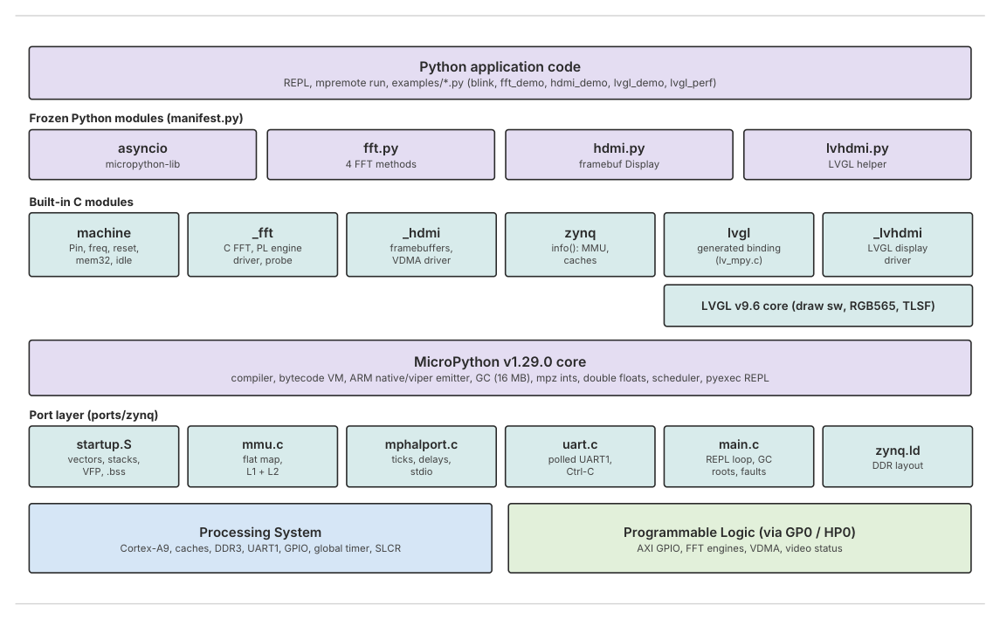
*Software layers (architecture.pdf, Figure 13).*

1. `program.sh` resets the PS, loads `system.bit`, runs `ps7_init` (PLLs, MIO, DDR) and
   `ps7_post_config` (PS-PL level shifters, FCLK reset), then `dow`s `firmware.elf` into
   DDR at 0x0010_0000 and starts CPU0.
2. `startup.S` → `zynq_start()` turns on the MMU and caches, starts the global timer,
   sets up UART1 (115200 from the 100 MHz UART clock) and runs the REPL.
3. With no interrupts in this port, the VM polls UART1 every 64 backward branches and
   during sleeps, so Ctrl-C reaches running code.
4. `Pin("LED1").on()` is a single 32-bit store to 0x4120_0000. It travels over GP0 and the
   AXI interconnect to the `axi_gpio` register, which drives W13.

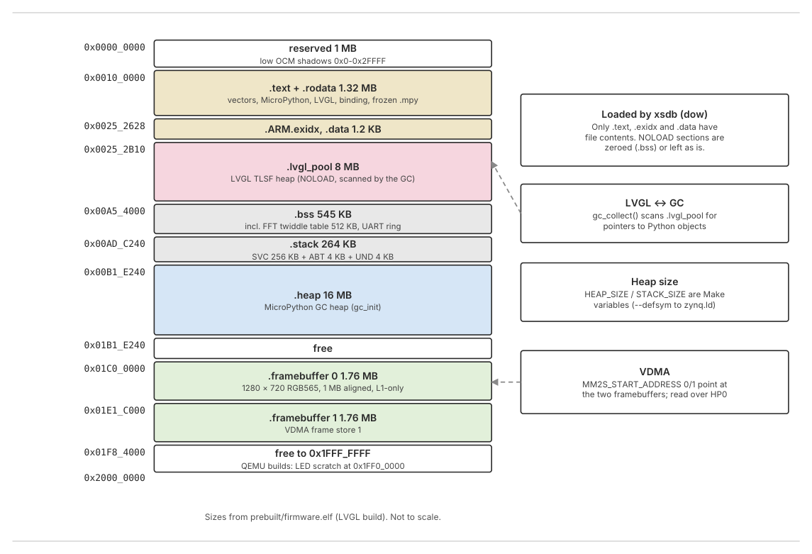
*Firmware layout in DDR (architecture.pdf, Figure 14).*

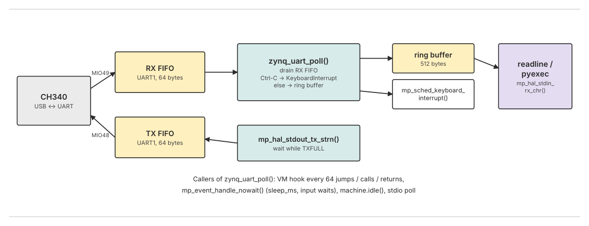
*Receive and transmit paths of the REPL on UART1 (architecture.pdf, Figure 15).*

## Adding more PL I/O

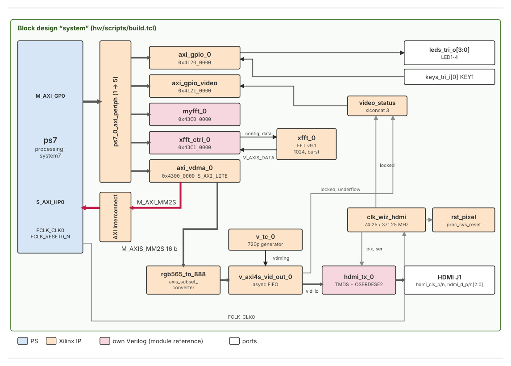
*The block design built by `hw/scripts/build.tcl` (architecture.pdf, Figure 5).*

- More GPIO (for example the 34 J3 header pins): widen `axi_gpio_0` or add `axi_gpio_1` in
  `hw/scripts/build.tcl` and add the pins to the XDC. Then add entries to
  `machine_pin_obj[]` in `ports/zynq/machine_pin.c` (a new `kind` per channel/base).
- Your own AXI4-Lite peripheral: place it in the GP0 window (0x4000_0000–0x7FFF_FFFF)
  and access it from Python with `machine.mem32[addr]` straight away. The MMU already maps
  that range as strongly-ordered memory. `hw/rtl/axil_slave.v` is a small AXI4-Lite slave
  to start from, and the FFT engines show how to add one as a block design module reference.
- If you change the CPU or UART clocks in `ps7_config.tcl`, update `ZYNQ_CPU_HZ` /
  `ZYNQ_UART_REF_HZ` in `ports/zynq/zynq_regs.h`.

The two 2×20 headers on schematic sheet 11: J2 carries PS MIO10–39, 46, 47, 52 and 53 (MIO10–15 at
3.3 V, the rest at 1.8 V), J3 carries 34 PL bank 34 I/O at 3.3 V. Pins 1, 19 and 22 are GND, 20 and 21 are
3.3 V, and 40 is 5 V. The Zynq ball of each J3 net is on sheet 8, and the PCB back silkscreen shows it too.

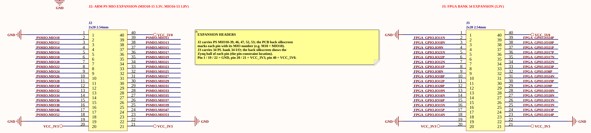
*Schematic sheet 11, expansion headers.*

## Testing without the board

`./build.sh qemu` builds a variant for QEMU's `xilinx-zynq-a9` machine (`apt install
qemu-system-arm`) and opens its REPL on UART1. QEMU has no PL, so the AXI GPIO is
redirected to a DDR scratch area at 0x1FF0_0000, above the framebuffers. You can watch the LED bits with
`hex(machine.mem32[0x1FF00000])`. The `"python"` and `"c"` FFT methods work there too;
the PL engines report "not available". Quit with Ctrl-A x.

`hdmi.Display(hardware=False)` draws into the same framebuffers in QEMU.
`tools/qemu_fb.py firmware.elf script.py out.png` runs a script there (paste mode),
dumps framebuffer 0 through the QEMU monitor and saves it as a PNG (needs Pillow).
That's how `docs/hdmi_demo.png` was made, from `examples/hdmi_demo.py` with `main(anim_seconds=0)`.
For LVGL, pass `lv` as the buffer index to dump the frame LVGL presented last; `docs/lvgl_demo.png`
is `examples/lvgl_demo.py` with `main(5000)`.

Plain QEMU runs as fast as your PC, so its fps says nothing about the board. With
`QEMU_EXTRA="-icount shift=1"`, `tools/qemu_fb.py` ties guest time to instructions (2 ns each,
about a 666 MHz A9), which gives realistic timings apart from cache and DDR effects. That's
how the LVGL figures above were measured.

## Troubleshooting

- **No banner on UART1:** check that `program.sh` ran `ps7_init` without errors. The firmware
  runs from DDR, so DDR has to work. If it doesn't, check `PCW_UIPARAM_DDR_*` in
  `ps7_config.tcl` (the earlier blink demo runs from OCM and doesn't need DDR). Rebuild
  with `make -C ports/zynq MMU=0 MICROPY_DIR=../../micropython` to rule out the cache setup,
  or with `L2=0` to leave only the L2 cache off.
- **`*** FATAL: data abort ... (PL address: is the bitstream loaded?)`:** an access to the
  GP0 window found no slave. Load the bitstream with `program.sh`.
- **Garbled text:** the UART reference clock isn't 100 MHz. Check `UART_CLK_CTRL` in
  `hw/build/ps7_init.html`.
- **No HDMI picture:** check `hdmi.Display().status()`:
  - `mmcm_locked` False: the pixel clock isn't running. Check `clk_wiz_hdmi` in the block design.
  - `video_locked` False or `underflow` True: vid_out isn't getting pixels fast enough. Check that `halted`/`error` are False; an `error` means the VDMA got a bus error reading DDR.
  - Everything True but still no picture: some monitors take a few seconds to lock onto a DVI signal, or need the HDMI cable plugged in before `Display()` starts the output.
- **Colours swapped or shifted:** the RGB565 → `{R,B,G}` mapping is `TDATA_REMAP` in
  `hw/scripts/build.tcl`, and `hdmi_tx.v` takes R from bits 23:16, B from 15:8, G from 7:0.
